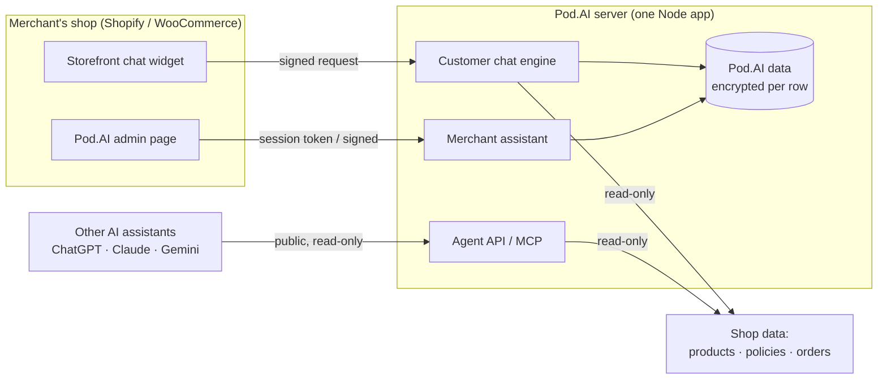
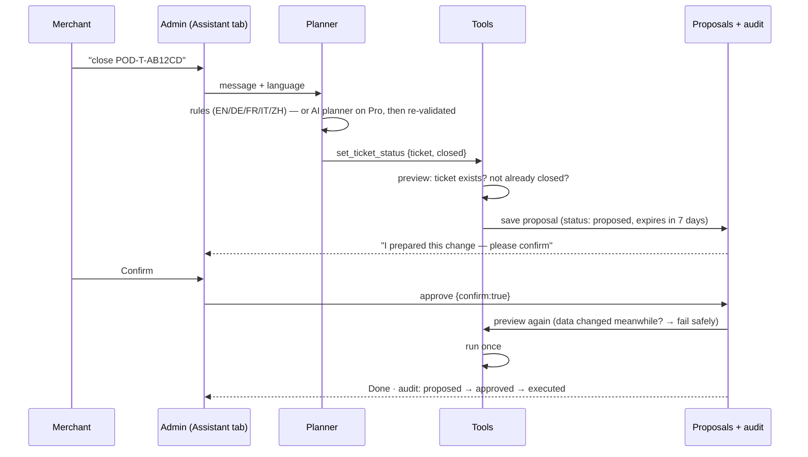

# Pod.AI handbook — architecture, processes and maintenance

> **Who this is for:** anyone who runs, sells, supports or changes Pod.AI — no coding needed for sections 1–6.
> Developers: sections 7–13.
> **Last updated:** 2026-11-20 · covers `main` + the merchant assistant (branch `podai/merchant-assistant`).
> **Scope:** Pod.AI only (Shopify app, WooCommerce plugin, agent API). The POD wedding site (pod.swisspro.site) is a separate product; later it will become a Pod.AI *customer* through the same adapter interface (see §12.3).

---

## 1. Pod.AI in one minute

Pod.AI is an **AI agent for online shops**. A merchant installs it (Shopify app or WooCommerce plugin) and gets three agents that work on the shop's own data:

| Agent | Who talks to it | What it does | Can it change things? |
|---|---|---|---|
| **Customer chat** (external) | Shoppers on the store | Answers product, shipping, policy and order-status questions in the shopper's language; shows product cards with add-to-cart; hands hard cases to the team as a ticket | Only in the shopper's own session (add to cart, open checkout link). Never takes payment. |
| **Agent API / MCP** (external) | Other AI assistants (ChatGPT, Claude, Gemini, Grok, custom agents) | Lets them search the store's in-stock products and build a prefilled checkout link | No. Read-only. The shopper always pays on the store's own checkout. |
| **Merchant assistant** (internal) — *new* | The merchant and their team, inside the Pod.AI admin | Daily briefing, KPIs, unanswered questions, tickets with reply drafts, knowledge upkeep, pause/resume chat | Only Pod.AI's own data, and **only after the merchant clicks Confirm**. Never the store, orders or products. |



---

## 2. The products and where they live

| Product | Status (2026-11-20) | Code | Public URL |
|---|---|---|---|
| **Pod.AI for Shopify** | Released app versions up to `pod-ai-10` in the Shopify Dev Dashboard; **not yet submitted to the App Store** | `server/shopify-agent/` + `apps/shopify-agent/` (Shopify CLI project, theme app extension) | Admin: `https://podai.swisspro.site/shopify-agent` (embedded in Shopify admin) |
| **Pod.AI Chat for WooCommerce** | Plugin 1.1.0 built (zip + WordPress.org assets); **not yet in the WordPress.org directory** | `server/woo-agent/` + `apps/woocommerce-plugin/` | Download: `https://podai.swisspro.site/woocommerce/pod-ai-chat.zip` |
| **Agent API (MCP + REST)** | Live for connected stores with "AI agent access" on (default on) | `server/agent-api/` | `https://podai.swisspro.site/agent/v1/stores/<store>` |
| **Billing** | Shopify: Managed Pricing (live). WooCommerce: Paddle (built, **off** until `PADDLE_*` is set) | `server/shopify-agent/billing.js`, `server/woo-agent/billing.js`, `server/billing/` | — |
| **Landing + legal pages** | Live | `server/shopify-agent/*.html` | `podai.swisspro.site` · `/privacy` `/terms` `/support` `/security` `/dpa` `/woocommerce` |

**Plans** (same for both platforms): Free 50 chats/month · Growth $19, 500 chats · Pro $49, 2,500 chats + AI model answers. The merchant assistant is included in every plan; its optional AI planner follows the plan's AI rule (Pro).

---

## 3. External process A — how a shopper's question is answered

```mermaid
flowchart TD
  Q[Shopper types a question] --> V[Verify request<br/>Shopify App Proxy signature / WooCommerce HMAC]
  V --> G[Plan limit check<br/>chats this month]
  G --> S[Safety first<br/>prompt-injection, card numbers, abuse,<br/>'I want a person', refund/legal → team]
  S --> R{Can the local engine<br/>answer confidently?}
  R -->|yes| L[Rules + shop data<br/>products · policies · shipping zones ·<br/>order status (number + e-mail) · discount check · merchant FAQ]
  R -->|no, Pro plan + AI on| M[AI model — may only call the same tools]
  R -->|no AI| B[Best local answer + offer a person]
  L --> A[Answer in the shopper's language<br/>+ cards: products, order, tracking, checkout]
  M --> A
  B --> A
  A --> K[Stats for the dashboard<br/>answered by rules / AI, unanswered, handoff]
```

Key rules (enforced in code, not by the AI's goodwill):
- **Local first.** Most answers come from rules + the shop's real data — fast, free, never invented. The AI model is only for complex questions, only on Pro, only if the merchant switched it on.
- **Order privacy.** Order status only when order number **and** order e-mail match; 5 wrong tries → 15-minute lock.
- **No payment data.** Card numbers are refused and never stored.
- **Handoff → ticket.** When a person is needed and the shopper leaves an e-mail, Pod.AI creates ticket `POD-T-XXXXXX` and e-mails the transcript to the **merchant** (Reply-To = shopper). The merchant answers from their own mailbox. While a ticket is open the AI keeps answering simple questions; "Back to AI" after resolve or 24 h idle.

Code: `server/shopify-agent/engine/` (agent.js → guardrails.js → nlu.js → router.js → tools via `profile.js` / `woo-agent/adapter.js`).

---

## 4. External process B — other AI assistants buying from the store

An AI assistant (e.g. ChatGPT with an MCP connector) can:
1. `search_products` — in-stock, priced products only.
2. `get_product` — one product with variants.
3. `create_checkout_link` — a prefilled cart link (Shopify `/cart/…` permalink, WooCommerce `?podai_cart=`).

The shopper opens the link and pays on the store's own checkout. Pod.AI never sees payment data. The merchant can switch this off (Settings → "AI agent access").
Endpoints: `GET /.well-known/pod-ai-agent.json`, `GET /agent/v1/openapi.json`, `POST /agent/v1/stores/<store>/mcp` (MCP Streamable HTTP). Rate-limited per IP and per store.

---

## 5. Internal process — the merchant assistant (new)

### 5.1 What the merchant sees

Pod.AI admin → **Assistant** tab (Shopify: inside the embedded admin; WooCommerce: API ready, WP admin page is the next step — see §14).

- A chat box with quick buttons: *What needs my attention today? · Unanswered questions · Open tickets · KPIs last 30 days · What do shoppers ask about?*
- Answers with cards: ticket list (late tickets in red), unanswered questions with **Teach answer**, a ticket with a **reply draft** (Copy / Open in e-mail), topic bars.
- **Waiting for your confirmation:** every change the assistant prepared, with **Confirm** / **Reject**.
- **Recent activity:** who asked, what was prepared, confirmed, done, rejected or failed.
- Admin languages EN / DE / FR / IT; the assistant also understands Chinese.

### 5.2 What you can ask (examples)

| You type | The assistant does | Changes data? |
|---|---|---|
| `What needs my attention today?` · `Was steht heute an?` · `今天重点` | Briefing: chats this week, AI resolution, hours saved, unanswered questions, open + late tickets, plan usage, chat paused? + suggested next steps | No |
| `KPIs last 7 days` · `Kennzahlen 30 Tage` · `统计 90天` | KPI report with change vs. the previous period | No |
| `Unanswered questions` · `questions sans réponse` | List of questions the chat could not answer (90 days) | No |
| `Open tickets` · `Offene Tickets` · `工单` | Tickets waiting for the team, oldest first, late ones flagged | No |
| `show POD-T-AB12CD` | Ticket transcript + reply draft in the shopper's language | No |
| `What do shoppers ask about?` | Top topics + languages | No |
| `search "Iceland"` | Chats that mention the phrase | No |
| `knowledge` · `FAQ` | Your knowledge entries | No |
| `answer "Do you ship to Iceland?" with "Yes, 7–15 business days."` · `Q: … A: …` · `Frage: … Antwort: …` · `问：… 答：…` | **Prepares** a knowledge entry (or an update if the question exists) | After Confirm |
| `close POD-T-AB12CD` · `POD-T-AB12CD pending` · `reopen POD-T-AB12CD` | **Prepares** a ticket status change | After Confirm |
| `POD-T-AB12CD note: called the customer` | **Prepares** an internal ticket note | After Confirm |
| `delete kb_1a2b3c4d` | **Prepares** removing a knowledge entry | After Confirm |
| `pause the chat` · `resume the chat` · `暂停聊天` | **Prepares** switching the storefront chat off / on | After Confirm |

### 5.3 How it works inside



Safety rules (in code):
1. **Read tools run, write tools only propose.** Nothing changes until a person clicks Confirm (`{confirm:true}` is required by the API).
2. **Checked twice.** The preview runs when proposing and again right before executing. If a teammate changed the ticket in the meantime, the action fails with a clear reason instead of acting on old data.
3. **Runs once.** A proposal can be executed only once (status guard + lock). Duplicates are merged. Max 25 open proposals per shop; unconfirmed proposals expire after 7 days.
4. **Own data only.** The assistant can change knowledge entries, ticket status/notes and chat on/off — never the store, orders, products or customers (the Shopify app only has read scopes).
5. **AI is optional and boxed in.** The AI planner (Pro + AI on) only chooses tools; every argument is validated again; unknown tools are dropped; if anything fails it falls back to rules. Replies are written by fixed templates, so numbers are never invented.
6. **Privacy.** Reading tickets or chats is written to the personal-data access log. The assistant's own audit log stores events and tool names only — no chat text, no e-mails. All records are encrypted at rest and deleted with GDPR requests and on uninstall/disconnect.

### 5.4 The tools (the assistant's "skills")

| Tool | Kind | What |
|---|---|---|
| `briefing` | read | Week summary + suggestions |
| `kpi_report` | read | KPIs 7/30/90 days with trend |
| `unanswered` | read | Questions the chat could not answer |
| `top_topics` | read | Intents + languages |
| `open_tickets` | read · personal data | Waiting tickets, late flag vs. reply target |
| `ticket_detail` | read · personal data | Transcript, notes, reply draft |
| `knowledge_list` | read | Merchant's FAQ entries |
| `search_chats` | read · personal data | Find chats by phrase |
| `add_knowledge` | write (confirm) | New entry or update of the same question |
| `delete_knowledge` | write (confirm) | Remove an entry |
| `set_ticket_status` | write (confirm) | open / pending / closed (closed → AI answers that chat again) |
| `add_ticket_note` | write (confirm) | Internal note |
| `set_chat_enabled` | write (confirm) | Pause / resume storefront chat |

---

## 6. How a merchant gets set up (operations checklist)

**Shopify:** install from the Dev Dashboard / App Store → open the app once (creates the offline token) → Online Store → Customize → App embeds → turn on **Pod.AI Chat** → in Pod.AI admin: Knowledge (add FAQ), Settings (ticket e-mail, colours, greeting) → Overview checklist turns green. Protected customer data (e-mail) must be approved by Shopify for order lookups.

**WooCommerce:** upload `pod-ai-chat.zip` → activate → *Connect* (Pod.AI verifies the site by callback, then issues a site secret) → products sync automatically → set ticket e-mail and look in the plugin settings.

**Daily for the merchant:** open **Assistant → What needs my attention today?** and work through the suggestions (teach answers, close tickets).

---

## 7. Code map (developers)

| Folder / file | What it is | Edit? |
|---|---|---|
| `server/shopify-agent/engine/` | Customer chat engine shared by all channels (guardrails, NLU, router, recommendations, tickets, KPIs, LLM) | Yes — Pod.AI only, never the site agent |
| `server/shopify-agent/merchant/` | **Merchant assistant**: `tools.js` (skills), `planner.js` (words → plan), `actions.js` (proposals, confirm, audit), `reply.js` (answer text, 5 languages), `index.js` (entry) | ✎ `tools.js`, `planner.js` WORDS, `reply.js` texts |
| `server/shopify-agent/profile.js` | Shopify data adapter (Admin GraphQL) | Yes |
| `server/shopify-agent/core.js` | Shopify config, install rows, session/proxy/webhook verification | Carefully |
| `server/shopify-agent/routes.js` | Shopify routes: proxy chat, embedded admin API (incl. `/api/assistant*`), webhooks | Yes |
| `server/shopify-agent/admin.html` | Embedded admin UI (Overview, **Assistant**, Tickets, Knowledge, Settings, Try it) | Yes |
| `server/shopify-agent/billing.js` | Shopify Managed Pricing plans + chat limits | Plans only |
| `server/shopify-agent/gdpr.js` | GDPR webhooks + retention purge | Carefully |
| `server/shopify-agent/security/` | Encryption at rest, backups, access log | Rarely |
| `server/woo-agent/` | WooCommerce channel: site registration + HMAC, adapter, catalogue, Paddle billing, routes (incl. `/woo-agent/v1/assistant*`) | Yes |
| `server/commerce-agent/index.js` | Platform-agnostic entry (adapter contract) — re-exports chat engine + `merchant` | When adding a platform |
| `server/agent-api/` | External AI agents: REST + MCP + OpenAPI | Yes |
| `server/billing/` | Paddle checkout page + webhook | Rarely |
| `apps/shopify-agent/` | Shopify CLI project (`shopify.app.toml`, theme app extension) | Deploy with `shopify app deploy` |
| `apps/woocommerce-plugin/` | WordPress plugin (PHP), translations, WP.org assets; build with `node scripts/build-woo-plugin.mjs` | Yes |

**Boundary rule:** files in `server/shopify-agent/` may only import Pod.AI files and a short allow-list of neutral helpers (store, crypto, carrier tracking clients). `server/shopify-agent/test/audit.test.js` fails the build otherwise. That is why the merchant assistant lives in `server/shopify-agent/merchant/`.

---

## 8. Data — what is stored, how long, how it is deleted

All Pod.AI records live in the app's data store (`data/store.json` on the server), **encrypted per row** (AES-256-GCM, key from `PODAI_DATA_KEY` or `APP_ENCRYPTION_KEY`). Every shop / site is its own tenant: `shopagent_<shop>.myshopify.com` or `wooagent_<site id>`. The tenant comes **only** from a verified Shopify token/signature or a WooCommerce HMAC — never from a request field.

| Collection | Content | Kept | Deleted on |
|---|---|---|---|
| `podai_shops` / `podai_woo_sites` | Install rows, encrypted tokens / site secret | While installed | `shop/redact` / disconnect |
| `podai_settings` | Chat settings, greeting, widget look, merchant FAQ | While installed | `shop/redact` / disconnect |
| `podai_conversations` | Chats (capped, redacted) | 12 months after last activity | customer/shop redact, disconnect |
| `podai_handoffs` | Tickets / handoffs | 12 months | customer/shop redact, disconnect |
| `podai_events` | Storefront clicks (no personal data) | 13 months | shop redact, disconnect |
| `podai_usage` | Chat counter for plan limits | 13 months | shop redact, disconnect |
| `podai_merchant_actions` *(new)* | Assistant proposals + results | 13 months | shop redact, disconnect; customer redact if they quote the customer's e-mail |
| `podai_merchant_audit` *(new)* | Assistant events (no chat text) — max 2,000 per shop | 13 months | shop redact, disconnect |
| `podai_gdpr` | GDPR request log | 3 years | shop redact |

Also: encrypted daily backups (14 days, `~/podai-backups`), personal-data access log (monthly files, 12 months). WooCommerce product catalogues are stored per site in separate files (public product data only).

---

## 9. Security and privacy rules (summary)

- Shopify: App Bridge session tokens (admin), App Proxy signatures (storefront), HMAC (webhooks), expiring offline tokens with refresh.
- WooCommerce: per-site secret, HMAC-SHA256 on every request (±5 min, single-use nonce), site verified by callback at registration.
- Merchants never see server secrets or env var names. No payment data. Prompt-injection and card-number filters.
- Personal data access is logged; GDPR webhooks implemented; retention purge daily.
- Merchant assistant: confirm-before-write, own data only, audit without content (see §5.3).

---

## 10. Configuration (server `.env`, names only)

| Variable | For |
|---|---|
| `AGENT_SHOPIFY_API_KEY`, `AGENT_SHOPIFY_API_SECRET`, `AGENT_APP_URL`, `SHOPIFY_APP_HANDLE` | Shopify app |
| `APP_ENCRYPTION_KEY` (≥32 chars), optional `PODAI_DATA_KEY` | Encryption at rest |
| `PODAI_BACKUP_DIR`, `PODAI_ACCESS_LOG_DIR` | Backups / access log location |
| `LLM_ENABLED`, `LLM_PROVIDER`, `<PROVIDER>_API_KEY`, `<PROVIDER>_MODEL` | Optional AI answers (Pro) and AI planner |
| `PODAI_ASSISTANT_LLM=off` | Force the merchant assistant to rules only even when AI is available |
| `TRACKING51_API_KEY`, `PODAI_YUNEXPRESS_MODE`, `PODAI_FOURPX_MODE` | Parcel tracking for order answers |
| `PADDLE_ENABLED`, `PADDLE_ENV`, `PADDLE_API_KEY`, `PADDLE_CLIENT_TOKEN`, `PADDLE_WEBHOOK_SECRET`, `PADDLE_PRICE_*` | WooCommerce billing |
| `PODAI_GA_ID`, `PODAI_LISTING_GA_ID` | Optional analytics on public pages / admin |
| `PODAI_PUBLIC_URL` | Public base for Pod.AI links (default `https://podai.swisspro.site`) |

---

## 11. Deploy, run, test

- Pod.AI runs **inside the same Node app** as the website (cPanel / CloudLinux, Passenger). Deploy + restart: see `docs/DEPLOYMENT.md` (`git pull` + `cloudlinux-selector restart`). No database migration is needed for the assistant (new collections are created on first use).
- Shopify config changes (scopes, webhooks, extension): `cd apps/shopify-agent && shopify app deploy`, then release the version. **The assistant needs no new scopes and no new app version** — it is server + admin page only.
- WooCommerce plugin: `node scripts/build-woo-plugin.mjs` → `apps/woocommerce-plugin/dist/`.
- **Tests:** `npm run test:all` (44 files, all offline, mocked Shopify/WordPress). Pod.AI only: `npm run test:all -- shopify-agent woo agent-api billing`. Assistant only: `node server/shopify-agent/test/merchant-agent.test.js`.
- After deploy check: `/shopify-agent/privacy` 200 · open the app in a Shopify dev store → Assistant tab → "What needs my attention today?" answers · Confirm a test knowledge entry and see it under Knowledge.

---

## 12. How to extend (step by step)

### 12.1 Add a new assistant skill
1. `server/shopify-agent/merchant/tools.js`: copy a similar tool. Fill `name`, `kind` (`read`/`write`), `llm` (one English line), `args`, `parse`, `run`; for `write` also `preview` (checks + `summary`/`effect`). Mark `personal: true` if it reads chats or tickets.
2. `planner.js`: add trigger words to `WORDS` (one regex for all languages) and a line in `rulePlan`.
3. `reply.js`: add the sentence in all five languages (`P`) and a line in `LINES`.
4. `admin.html`: add a label `as.t.<tool>` (EN/DE/FR/IT) and, if it returns a list, a card in `asResult`.
5. Add a test in `server/shopify-agent/test/merchant-agent.test.js`; run `npm run test:all`.

### 12.2 Teach the assistant new words
Edit the regex for that intent in `WORDS` (planner.js). Add the phrase to the planner test.

### 12.3 Connect a new platform (e.g. the POD website as a Pod.AI customer)
1. Write an adapter with the contract in `server/commerce-agent/index.js` (`facts`, `searchProducts`, `findOrder`, `shippingRates`, `checkDiscount`).
2. Give it its own tenant prefix and authentication (like `server/woo-agent/core.js`).
3. Add channel routes that call `handleChat(...)` for shoppers and `merchant.runAssistant(ctx, message)` / `approve` / `reject` for the team — the same 5 calls Shopify and WooCommerce use.
4. Add the new collections to deletion on disconnect. Nothing in the engine or the assistant needs to change.

### 12.4 Turn on the AI planner
Server: `LLM_ENABLED=true` + provider key/model. Merchant: Pro plan + Settings → "LLM answers" on. The assistant then shows "AI planner" instead of "Rules". `PODAI_ASSISTANT_LLM=off` disables it globally.

---

## 13. Glossary

- **Tenant** — one shop or site; all data is separated by tenant.
- **Handoff / ticket** — a chat passed to the merchant's team; with an e-mail it gets a `POD-T-…` number.
- **Proposal / action** — a change the merchant assistant prepared; runs only after Confirm.
- **Local first** — answer from rules + real shop data before (optionally) asking an AI model.
- **MCP** — Model Context Protocol; the standard other AI assistants use to call Pod.AI's store tools.

---

## 14. Roadmap — next steps for a "super agentic" Pod.AI

| # | Next | Why |
|---|---|---|
| 1 | **WooCommerce admin page for the assistant** (PHP page calling `/woo-agent/v1/assistant*`; plugin 1.2.0 + translations) | API is ready and tested; WP merchants get the same assistant |
| 2 | **Submit to Shopify App Store** (real screenshots incl. Assistant, protected-data request, fresh-store test) and **WordPress.org** | Distribution |
| 3 | **Weekly assistant e-mail** (briefing + unanswered questions) to the ticket e-mail | Merchants act without opening the app |
| 4 | **AI-drafted answers for unanswered questions** (Pro): the assistant proposes the answer text from policies + products; merchant confirms | Faster knowledge growth, higher resolution rate |
| 5 | **Proactive shopper agent**: abandoned-cart / back-in-stock follow-ups as merchant-approved proposals | Revenue, not just support |
| 6 | **Agentic checkout (ACP / UCP)** in the Agent API | AI assistants complete purchases end-to-end |
| 7 | **POD website as a Pod.AI customer** via a new adapter (§12.3) | Dog-food the product on our own store |
